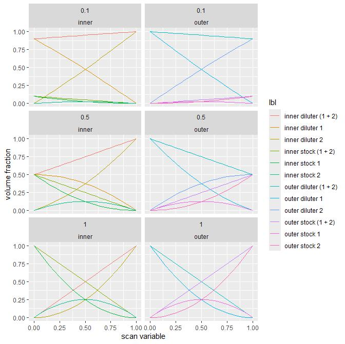

The folder contains files required to run 3i1D_HLD_scan_v3. The scan simultaneously varies 3 variables - EACN, salinity, and ratio between concentration of oil soluble surfactant and concentration of aqueous phase soluble surfactant.

The scan assumes that a tested system contains two surfactants, one oil and one water soluble.

Setup files assumes that user has:

- 4 main stock solutions:
    - 2 stocks for oil phase, 
    - 2 stocks for aqueous phase. 
- 4 dilution liquids:
    - 2 dilution oils - one for each oil stock
    - 2 dilution liquids for aqueous phase - one for each stock
- surfactant concentration values are used to calculate dilution to obtain run stocks

## Note

I don't have a consistent terminology here, but because of typical choices (aqueous solutions and C7/C16 as oil)
aqueous phase is inner phase and oil is outer phase!!! While executing the scan you will see something like:

```
        '9/A1': "INNER STCK1",
        '9/A2': "INNER DIL1",
        '9/A3': "INNER STCK2",
        '9/A4': "INNER DIL2",
        '9/B1': "OUTER STCK1",
        '9/B2': "OUTER DIL1",
        '9/B3': "OUTER STCK2",
        '9/B4': "OUTER DIL2"
```

indicating locations of different input solutions. In this particular case followin is true:

```
      SAQ1 is  "INNER STCK1",
      DAQ1 is  "INNER DIL1",
      SAQ2 is  "INNER STCK2",
      DAQ2 is  "INNER DIL2",
      SO1  is  "OUTER STCK1",
      DO1  is  "OUTER DIL1",
      SO2  is  "OUTER STCK2",
      DO2  is  "OUTER DIL2"
```


# Workflow in brief

- prepare setting files
- prepare stock and dilution solutions and add their definitions to solution repository
- create run configuration files (using `3i1D_HLD_scan_v3__setup_configuration.py`)
- execute 2D HLD scan (using `3i1D_HLD_scan_v3__execute.py`)

# abbreviations

- `SMPL WST`: Sample waste; here remaining sample is discarded after measurement.
- `WASH1 WST`: Wash 1 waste; here a washing fluid is discarded after first set of washing steps.
- `WASH2 WST`: Wash 2 waste; here a sample fluid is discarded after washing steps with a sample fluid
- `WASH1`: A washing fluid source vial
- `SAQ1`: A main stock of aqueous phase 1;
- `SAQ2`: A main stock of aqueous phase 2;
- `SO1`: A main stock of oil phase 1; 
- `SO2`: A main stock of oil phase 2;
- `DAQ1`: A dilution fluid for aqueous phase 1;
- `DAQ2`: A dilution fluid for aqueous phase 2;
- `DO1`: A dilution fluid for oil phase 1;
- `DO2`: A dilution fluid for oil phase 2;
- `WASH`: A location of washing fluid for distribution;


# settings file

- A setting file contains inputs necessary to prepare run stocks, generate configuration files and execute experimental scan

## general parameters

- `DATA_PATH`: an absolute path to this set of experiment(s)
- `LOG_PATH`: an absolute path to log file generated during a scan
- `CONFIG_PATH`: an absolut path to folder that contains configuration files (opentron, mixing graph, measurement)
- `SOLUTION_REPOSITORY_PATH`: an absolute path to solution repository
- `c_surfactant_experiment`: a concentration of a surfactant in oil used in an experiment; float value that is less or eaqul to `c_surfactant_stock`
- `c_surfactant_stock`: a concentration of a surfactant in main oil stock, it is expected that both oil stocks contain the same concentration. 
- `c_surfactant_aq_experiment`: a concentration of a surfactant in aqueous phase used in an experiment; float value that is less or eaqul to `c_surfactant_aq_stock`
- `c_surfactant_aq_stock`: a concentration of a surfactant in main aqueous stock, it is expected that both aqueous stocks contain the same concentration. 
    - The necessary dilution is estimated from c_surfactant_stock and c_surfactant_experiment values, and scan variable (x).
     
     | solution        | fraction                           |
     |-----------------|------------------------------------|
     | inner stock 1   |   (1-x) * x_dilute * (1-x)         |
     | inner diluter 1 |   (1-x) * (1 - x_dilute * (1-x))   |
     | inner stock 2   |   x     * x_dilute * (1-x)         |
     | inner diluter 2 |   x     * (1 - x_dilute * (1-x))   |
     | outer stock 1   |   (1-x) * x_dilute * x             |
     | outer diluter 1 |   (1-x) * (1 - x_dilute * x)       |
     | outer stock 2   |   x     * x_dilute * x             |
     | outer diluter 2 |   x     * (1 - x_dilute * x)       |
     
    - `x_dilute = c_surfactant_experiment / c_surfactant_stock` 
    - few examples of dilutions are shown below for `x_dilute = {0.1, 0.5, 1.0}`

     {width=100%}

## Stocks

- subsection `stocks` in settings file contains names of various solutions used in experiment. The solutions are stored in the solution repository associated with the experiment(s). The names given in this section have to match exactly names of solutions availabel in the solution repository. E.g. `heptane` and `Heptane` are two different names!
- `surfactant_in_oil_1`: a name of main stock of an oil phase 1,
- `surfactant_in_oil_2`: a name of main stock of an oil phase 2,
- `oil_1`: a name of a diluter of an oil phase 1,
- `oil_2`: a name of a diluter of an oil phase 2,
- `stock_aqueous_1`: a name of main stock of an aqueous phase 1,
- `stock_aqueous_2`: a name of main stock of an aqueous phase 2,
- `diluter_aqueous_1`: a name of diluter fluid of an aqueous phase 1,
- `diluter_aqueous_2`: a name of diluter fluid of an aqueous phase 2,

## Configurations

- this section contains labels to derive names of configurations files.
- `blank`: a generic name of blank configuration files used as template
- `start`: a label of start configuration
- `end`: a label of end configuration
- `to_reuse`: a label of configuration to be reused; handy in case when some intermediate solutions are prepared in previous runs and can be reused

## Scan

- `experiment_metadata`: string entries of user defined metadata; these fields are added into experimental data 
- `n_expansions": integer, not used
- `n_approximation`: integer, not used at the moment, leave value at `0`
- `number_of_oil_points": integer, number of points to sample in the scan
- `oil_volume": float, volume of outer solution in uL added to a cuvette
- `scan_type": a string, not used, leave as "linear"


# opentron starting conditions

## run stock preparation: layout

- there are no run buffers that needs preparation. For 3i1D scan this step is skipped!

## scan execution: layout

```
slot 2:

          A1$        A2         A3         A4         A5         A6
          SMPL WST   WASH1 WST  WASH2 WST  WASH1      empty      empty
          0.5        0.5        0.5        1.4        0          0        

          B1         B2         B3         B4         B5         B6
          empty      empty      empty      empty      empty      empty       
          0          0          0          0          0          0          
          
          C1         C2         C3         C4         C5         C6
          empty      empty      empty      empty      empty      empty       
          0          0          0          0          0          0          
          
          D1         D2         D3         D4         D5         D6
          empty      empty      empty      empty      empty      empty       
          0          0          0          0          0          0          
          
          
slot 9:
          A1         A2         A3         A4         A5
          SAQ1       DAQ1       SAQ2       DAQ2       -
          12         12         12         12         -

          B1         B2         B3         B4         B5
          SO1        DO1        SO2        DO2        -
          12         12         12         12         -
          
          C1         C2         C3         C4         C5
          -          -          -          -          -
          -          -          -          -          -
        
 
```

($) - each well is described with 1) address label, 2) role, 3) volume; `-` well not used; `empty` - an empty eppendorff to mix inner solutions

