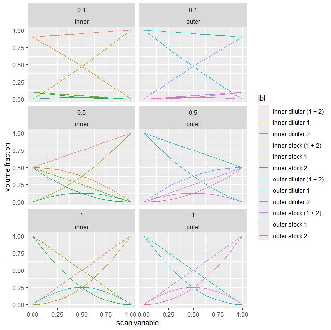
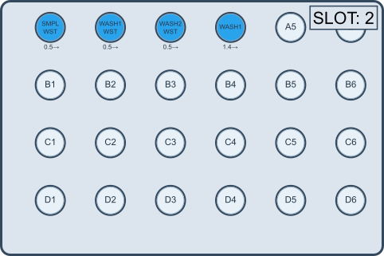
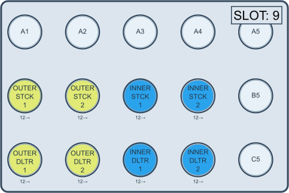
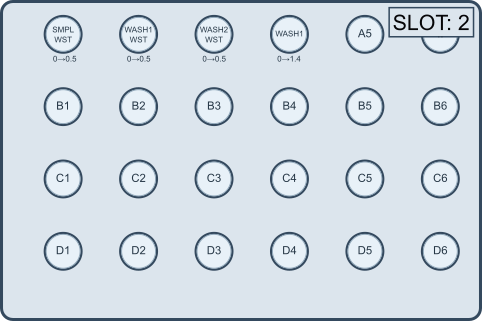
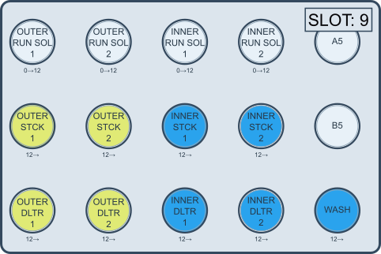
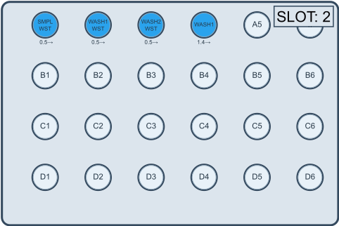
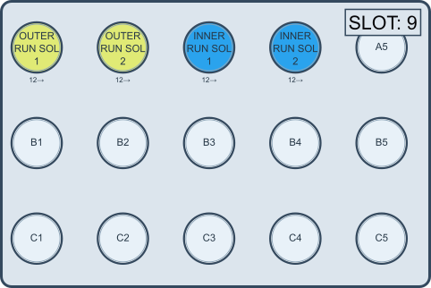
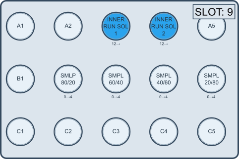
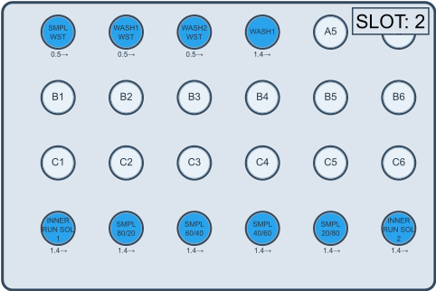
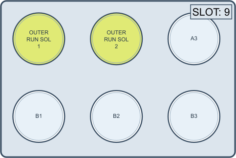

The folder contains files required to run:

- 3i1D_HLD_scan_v4
- 2D_HLD_scan_v4,
- 2D_HLD_OIW_scan_v4

All these runs are functionally equivalent to previous runs (<give examples of previous versions>). They have been reworked to have similar inputs in scan_settings.json file and have consistent solution locations.


# context

Hld scans are designed to explore IFT as a function of formulation parameters. A single measurement is a controlled injection of an inner solution into a larger amount (~3mL) of an outer solution. Every measurement gives qualitative assesment of IFT magnitude. At large IFT values, there is a distinct droplet formation; the larger IFT, the larger drop volume is observed. At lof IFT magnitudes, there is a stream of an inner solution observed. In addition to injection dynamics there are other interactions that can lead to gel (rag) phase formations that somewhat complicates qualitative IFT assessment. 

Hld scans are designed to capture influence of 2 parameters - salinity and EACN. For most systems a single two dimensional scan is not sufficient to characterize the system and multiple scans are necessary to properly analyse it. This package (hld_ift_analysis_helpers) contain scripts to facilitate this analysis process.

The scripts included at package/utils/acquire represent individual steps in the workflow. Parameters needed to run these scripts are collected in scan_settings.json file


## workflow in brief

- general note: The most important part of workflow is to execute hld scans. The rest of steps are meant to facilitate preparation of hld scans in systematic and uniform manner as much as possible.

- typical work flow includes following steps:
    - a preparation of a scan_setting file
    - a preparation of input solutions - stocks and dilution - and an addition of their definitions to a solution repository file
    - a preparation of run solutions 
    - a creation of configuration files - opentron configuration, mixing graph, measurement configuration
    - an execution of an hld scan 


--- 

# scans

## terminology

- **inner** solution: a fluid phase that is injected in small quantities via small diameter needle into a bulk liquid.
- **outer** solution: a bulk fluid into which *inner* solution is injected.
- inner/outer **run solution**: solutions that are directly used during the scan to mix various compositions of outer and inner solutions
- inner/outer **stock**; a solution with the highest concentration of surfactant
- inner/outer **diluter**; a soluton with no surfactant but having similar composition to a stock solution (e.g stock has 10g/100mL Tergitol 15-S-15 and 15g/100mL NaCl in water; diluter has 15g/100mL NaCl in water). A mixture of a stock and a related diluter solution gives an intermediate surfactant concentration during run (e.g 3iD_HLD_scan) or run solutions (e.g. 2D_HLD_scan)
- **upward** scan: a scan where an inner phase has lower density than an outer phase; such choice will a) result in a movement of the injected inner fluid upwards, to a top of a cuvette move upward and b) necessitates hook-shaped [J] needle
- **downward** scan: a scan were an inner phase has higher density than an outer phase; such choice will result in a movement of the injected fluid downwards, to a bottom of a cuvette and necessitates a straight [I] needle.

---

## 3i1D_HLD_scan_v4

- `3i1D_HLD_scan_v4` is designed to simultanously vary 3 distinct variables - salinity, EACN, and oil vs aqueous surfactant ration - and locate a parameter space with low IFT for further characterization.
- The scan requires 8 input solutions, their role is given in a table below
- A single variable `x` is changed in discrete fashion from 0 to 1 during a scan. The volume fraction of each particular input solution in an inner and an outer solution is given below:

 | source solution | fraction                           | target solution |
 |-----------------|------------------------------------|-----------------|
 | inner stock 1   |   `(1-x) * x_dilute * (1-x)`       | inner phase     |
 | inner diluter 1 |   `(1-x) * (1 - x_dilute * (1-x))` | inner phase     |
 | inner stock 2   |   `x     * x_dilute * (1-x)`       | inner phase     |
 | inner diluter 2 |   `x     * (1 - x_dilute * (1-x))` | inner phase     |
 |                 |                                    |                 |
 | outer stock 1   |   `(1-x) * x_dilute * x`           | outer phase     |
 | outer diluter 1 |   `(1-x) * (1 - x_dilute * x)`     | outer phase     |
 | outer stock 2   |   `x     * x_dilute * x`           | outer phase     |
 | outer diluter 2 |   `x     * (1 - x_dilute * x)`     | outer phase     |
 
    - `x_dilute = c_surfactant_experiment / c_surfactant_stock` 
    - few examples of dilutions are shown below for `x_dilute = {0.1, 0.5, 1.0}`


{width=100%}


## 2D_HLD_scan_v4

- `2D_HLD_scan_v4` is designed to create 2D grid scans for 2 distinct variables - salinity and EACN. 
- The scan requires 4 input solutions: 
    - 2 inner run solutions, and
    - 2 outer run solutions
- 2 inner run solutions are mixed in different fractions to create scan along one variable (e.g. salinity) and 2 outer solutions - along another (e.g. EACN).
- During a scan one of outer solution compositions is mixed within a cuvette and all compositions of an inner solution are tested against it; Then a new composition of an outer solution is prepared and testing against all inner solutions performed. The process is continued untill all outer compositions have been tested against all inner solution compositions
- A composition of an inner phase can be varied linerly or logarithmicly; a composition of an outer phase can be varied linearly

## 2D_HLD_OIW_scan_v4

- `2D_HLD_OIW_scan_v4` is a speciallized version of a `2D_HLD_scan_v4` for a volatile inner solution samples.
- Following limitations apply to this scan:
    - only 6 inner solution samples are possible
    - whole process is split into 3 scans, testing 2 inner solutions against all combinations of outer solution compositions
- a composition of an outer phase can be varied lineraly or logarithmicly.


---


# Workflows

# solution preparation

- a solution definition requires:
    - density, g/ml
    - composition of all ingredients as mass fraction (w/w)
- there is a tool to plan solution preparation (solution repository editor [ ] add script name!!!)
- weighing all components befor mixing is easiest way to create solutions (even liquids)
- for a density estimate small aliquots can be weighted and compared with standard liquid with known density (e.g. water)

# new experiment from an old (template) experiment

- use the script `create_new_profile.py` to create a new experiment folder from an old (template) experiment
- edit solution repository with the script `solution_repository_editor.py`

---

## Workflow: 3i1D_HLD_scan_v4

### in brief

- edit scan_settings file
- prepare all solutions and add them to a solution repository
- fill input solution according to an opentron configuration
- create configuration files
- execute run

- related commands:

```
[ ] add command prompt bits!!!
```

### setting up scan_settings.json

- The scan requires:
    - inner and outer stock solutions (4 in total)
    - inner and outer diluters (4 in total)
    - washing solution

### solution preparation and distribution

- a user is required:
    - to make stock and diluter solutions and enter their definitions into a solution repository
    - to manually distribute input solutions according to an copentron configuration given in the section `execution`:
        - fill waste and washing solutons;
        - fill stock and diluter solutions (each 12 mL)

### set up configuration (3i1D_HLD_scan_v4__setup_configuration.py)

- create configuration by running the script `3i1D_HLD_scan_v4__setup_configuration.py`

- the aforementioned script supplements blank configuration in the following way:
    - slot 2: `eppendorf_24_reservoir_1500ul`
        - `2/A1`: `sample waste`, 500 uL of washing solution
        - `2/A2`: `wash waste 1`, 500 uL of washing solution
        - `2/A3`: `wash waste 2`, 500 uL of washing solution
        - `2/A4`: `washing solution 1`, 1400 uL of washing solution
    - slot 9: `3dprinted_15_tuberack_15000ul`
        - `9/B1`: `outer stock 1`, 12000 uL
        - `9/B2`: `outer stock 2`, 12000 uL
        - `9/B3`: `inner stock 1`, 12000 uL
        - `9/B4`: `inner stock 2`, 12000 uL
        - `9/C1`: `outer diluter 1`, 12000 uL
        - `9/C2`: `outer diluter 2`, 12000 uL
        - `9/C3`: `inner diluter 1`, 12000 uL
        - `9/C4`: `inner diluter 2`, 12000 uL


### execution (3i1D_HLD_scan_v4__execute.py)

- run the script `3i1D_HLD_scan_v4__execute.py`
- the follow solutions configuration is expected at the beginning of the scan:

 
 


---

## Workflow: 2D_HLD_scan_v4

### setting up scan_settings.json

- requires:
    - inner and outer stocks and diluters should be valid solutions in the solution repository
    - valid and unique names for inner and outer run solutions

### prepare solutions (2D_HLD_scan_v4__prepare_solutions.py)

- run the script `2D_HLD_scan_v4__prepare_solutions.py`
- inputs: 
    - slot 9: `3dprinted_15_tuberack_15000ul`
        - `9/B1`: `outer stock 1`, 12000 uL
        - `9/B2`: `outer stock 2`, 12000 uL
        - `9/B3`: `inner stock 1`, 12000 uL
        - `9/B4`: `inner stock 2`, 12000 uL
        - `9/C1`: `outer diluter 1`, 12000 uL
        - `9/C2`: `outer diluter 2`, 12000 uL
        - `9/C3`: `inner diluter 1`, 12000 uL
        - `9/C4`: `inner diluter 2`, 12000 uL
        - `9/C5`: `washing solution`, 12000 uL

- outputs: 
    - slot 2: `eppendorf_24_reservoir_1500ul`
        - `2/A1`: `sample waste`, 500 uL
        - `2/A2`: `wash waste 1`, 500 uL
        - `2/A3`: `wash waste 2`, 500 uL
        - `2/A4`: `washing solution 1`, 1400 uL
    - slot 9: `3dprinted_15_tuberack_15000ul`
        - `9/A1`: `outer run solution 1`, 12000 uL
        - `9/A2`: `outer run solution 2`, 12000 uL
        - `9/A3`: `inner run solution 1`, 12000 uL
        - `9/A4`: `inner run solution 2`, 12000 uL





### set up configuration 

- create configuration by running the script `2D_HLD_scan_v4__setup_configuration.py`


### execution ()

- run the script `2D_HLD_scan_v4__execute.py`
- inputs: 
    - slot 2: `eppendorf_24_reservoir_1500ul`
        - `2/A1`: `sample waste`, 500 uL
        - `2/A2`: `wash waste 1`, 500 uL
        - `2/A3`: `wash waste 2`, 500 uL
        - `2/A4`: `washing solution 1`, 1400 uL
    - slot 9: `3dprinted_15_tuberack_15000ul`
        - `9/A1`: `outer run solution 1`, 12000 uL
        - `9/A2`: `outer run solution 2`, 12000 uL
        - `9/A3`: `inner run solution 1`, 12000 uL
        - `9/A4`: `inner run solution 2`, 12000 uL






---

## Workflow: 2D_HLD_OIW_scan_v4

### setting up scan_settings.json

### prepare solutions 

- *this step is exactly the same as for scan* `2D_HLD_scan_v4`
- run the script `2D_HLD_scan_v4__prepare_solutions.py`
- inputs: 
    - slot 9: `3dprinted_15_tuberack_15000ul`
        - `9/B1`: `outer stock 1`, 12000 uL
        - `9/B2`: `outer stock 2`, 12000 uL
        - `9/B3`: `inner stock 1`, 12000 uL
        - `9/B4`: `inner stock 2`, 12000 uL
        - `9/C1`: `outer diluter 1`, 12000 uL
        - `9/C2`: `outer diluter 2`, 12000 uL
        - `9/C3`: `inner diluter 1`, 12000 uL
        - `9/C4`: `inner diluter 2`, 12000 uL
        - `9/C5`: `washing solution`, 12000 uL

- outputs: 
    - slot 2: `eppendorf_24_reservoir_1500ul`
        - `2/A1`: `sample waste`, 500 uL
        - `2/A2`: `wash waste 1`, 500 uL
        - `2/A3`: `wash waste 2`, 500 uL
        - `2/A4`: `washing solution 1`, 1400 uL
    - slot 9: `3dprinted_15_tuberack_15000ul`
        - `9/A1`: `outer run solution 1`, 12000 uL
        - `9/A2`: `outer run solution 2`, 12000 uL
        - `9/A3`: `inner run solution 1`, 12000 uL
        - `9/A4`: `inner run solution 2`, 12000 uL


### distribute solutions: (2D_HLD_OIW_scan_v4__distribute_solutions.py)

- This step takes inner run solutions and creates 4 additional mixtures at following volumetric ratios: {80/20, 60/40, 40/60, 20/80}
- The inner run solutions and the obtained mixtures have to be manually transfered into 1.5mL vials, see next step!

- inputs: 
    - slot 9: `3dprinted_15_tuberack_15000ul`
        - `9/A3`: `inner run solution 1`, 12000 uL
        - `9/A4`: `inner run solution 2`, 12000 uL
- outputs: 
    - slot 9: `3dprinted_15_tuberack_15000ul`
        - `9/B2`: `sample 80/20`, 4000 uL
        - `9/B3`: `sample 60/40`, 4000 uL
        - `9/B4`: `sample 40/60`, 4000 uL
        - `9/B5`: `sample 20/80`, 4000 uL


{width=30%}


### setup configuration (2D_HLD_OIW_scan_v4__setup_configuration.py)

- create configuration by running the script `2D_HLD_OIW_scan_v4__setup_configuration.py`

### execute: (2D_HLD_OIW_scan_v4__execute.py) 

- inputs: 
    - slot 2: `eppendorf_24_reservoir_1500ul`
        - `2/A1`: `sample waste`, 500 uL
        - `2/A2`: `wash waste 1`, 500 uL
        - `2/A3`: `wash waste 2`, 500 uL
        - `2/A4`: `washing solution 1`, 1400 uL
        - `2/D1`: `inner run solution 1`, 1400 uL
        - `2/D2`: `sample 80/20`, 1400 uL
        - `2/D3`: `sample 60/40`, 1400 uL
        - `2/D4`: `sample 40/60`, 1400 uL
        - `2/D5`: `sample 20/80`, 1400 uL
        - `2/D6`: `inner run solution 2`, 1400 uL
    - slot 9: `3dprinted_50_tuberack_50000ul`
        - `9/A1`: `outer run solution 1`, 40000 uL
        - `9/A2`: `outer run solution 2`, 40000 uL






---

# Components


## settings file

- A setting file contains inputs necessary to prepare run stocks, generate configuration files and execute experimental scan

### general parameters

- `DATA_PATH`: an absolute path to this set of experiment(s)
- `LOG_PATH`: an absolute path to log file generated during a scan
- `CONFIG_PATH`: an absolut path to folder that contains configuration files (opentron, mixing graph, measurement)
- `SOLUTION_REPOSITORY_PATH`: an absolute path to a solution repository
- `c_surfactant_outer_run_solution`: a concentration of a surfactant in an outer run solution used in an experiment; float value that is less or eaqul to `c_surfactant_outer_stock`
- `c_surfactant_outer_stock`: a concentration of a surfactant in main oil stock, it is expected that both oil stocks contain the same concentration. 
- `c_surfactant_inner_run_solution`: a concentration of a surfactant in aqueous phase used in an experiment; float value that is less or eaqul to `c_surfactant_inner_stock`
- `c_surfactant_inner_stock`: a concentration of a surfactant in main aqueous stock, it is expected that both aqueous stocks contain the same concentration. 
    - The necessary dilution is estimated from c_surfactant_stock and c_surfactant_experiment values. A main stock is diluted with a diluter solution: 
        - v_stock = c_surfactant_experiment / c_surfactant_stock * v_total
        - v_diluter = v_total - v_stock

### Stocks

- subsection `stocks` in settings file contains names of various solutions used in experiment. The solutions are stored in the solution repository associated with the experiment(s). The names given in this section have to match exactly names of solutions availabel in the solution repository. E.g. `heptane` and `Heptane` are two different names!
- running solutions are created from main stocks and diluter fluids. Their names can be arbitrarily chosen and definition of these solutions are created during the solution prep step (__add_script_name__).

- `outer_stock_1`: a name of main stock of an oil phase 1,
- `outer_stock_2`: a name of main stock of an oil phase 2,
- `outer_diluter_1`: a name of a diluter of an oil phase 1,
- `outer_diluter_2`: a name of a diluter of an oil phase 2,
- `outer_run_solution_1`: a name of run stock of an oil phase 1,
- `outer_run_solution_2`: a name of run stock of an oil phase 2,
- `inner_stock_1`: a name of main stock of an aqueous phase 1,
- `inner_stock_2`: a name of main stock of an aqueous phase 2,
- `inner_diluter_1`: a name of diluter fluid of an aqueous phase 1,
- `inner_diluter_2`: a name of diluter fluid of an aqueous phase 2,
- `inner_run_solution_1`: a name of run stock of an aqueous phase 1,
- `inner_run_solution_2`: a name of run stock of an aqueous phase 2,
- `washing_solution`: a name of washing and waste solution

### Configurations

- this section contains labels to derive names of configurations files.
- `blank`: a generic name of blank configuration files used as template
- `start`: a label of start configuration
- `end`: a label of end configuration
- `to_reuse`: a label of configuration to be reused; handy in case when some intermediate solutions are prepared in previous runs and can be reused
- `blank_logout_OIW`: a generic name of blank configuration files used as template for OIW scan with logarithmic spacing in outer solution composition.
- `blank_OIW`:  a generic name of blank configuration files used as template for OIW scan with linear spacing in outer solution composition.

### Scan

- `experiment_metadata`: string entries of user defined metadata; these fields are added as header variable into an experimental data 
- `n_expansions": integer, number of times new data points are added to scan. The manner in which the data points are added depends on scan type:
    - `scan_type == "linear"`: a new data point is added at the midpoint between any two nearest neighbours
        - every expansion `n-1` data point is added, where `n` is number of data points in the scan before expansion
        - total number of points after `m-th` expansion is `2^m + 1`
        

         | total number of expansions | data points in a scan                                         |
         |----------------------------|---------------------------------------------------------------|
         | 0                          | {0, 1}*                                                       |
         | 1                          | {0, 0.5, 1}                                                   |
         | 2                          | {0, 0.25, 0.5, 0.75, 1}                                       |
         | 3                          | {0, 0.125, 0.25, 0.375, 0.5, 0.625, 0.75, 0.875, 1}           |
         | m                          | {0/2^m, 1/2^m, 2/2^m, ..., (2^m - 1)/2^m, 2^m/2^m}            |


         (*) - numbers given are relative concentrations, where stock 1 is considered to have concentration `0` and stock 2 - `1`. 


    - `scan_type == "log" `: a single new data point is added between stock 1 and the lowest dilution of stock 2
        - total number of points after `m-th` expansion is `m+1`

         | total number of expansions | data points in a scan                                         |
         |----------------------------|---------------------------------------------------------------|
         | 0                          | {0, 1}**                                                      |
         | 1                          | {0, 0.5, 1}                                                   |
         | 2                          | {0, 0.25, 0.5, 1}                                             |
         | 3                          | {0, 0.125, 0.25, 0.5, 1}                                      |
         | m                          | {0, 1/2^(m-0), 1/2^(m-1), 1/2^(m-2), ..., 1/2^1, 1/2^0}       |
        
         (**) point {0} is never measured

    - `scan_type == "log_and_mid"`: two new data points are added.
        - concentration_new_1: (c_0 + c_1) / 2
        - concentration_new_2: (concentration_new_1 + c_1) / 2
        - c_0 and c_1 are points with two lowest concentrations in a scan
        - total number of points after `m` expansions is `(m+1) * 2`

         | total number of expansions | data points in a scan                                             |
         |----------------------------|-------------------------------------------------------------------|
         | 0                          | {0, 1}***                                                         |
         | 1                          | {0, 0.5, 0.75, 1}                                                 |
         | 2                          | {0, 0.25, 0.375, 0.5, 0.75, 1}                                    |
         | 3                          | {0, 0.125, 0.1875, 0.25, 0.375, 0.5, 0.75, 1}                     |
         | m                          | {0, 2/2^(m+1), 3/2^(m+1), 2/2^m, 3/2^m, ..., 2/2^2, 3/2^2, 2/2^1} |
        
         

- `n_approximation`: integer, not used at the moment, leave value at `0`
- `number_of_outer_solution_points`: integer, number of different outer solution blends. outer solution is linearly blended from two stocks.
- `volume_of_outer_solution`: float, volume of outer solution in uL added to a cuvette; suggested value: 3000 to 3500
- `scan_type`: a string from set {"linear", "log", "log_and_mid"}, unrecognized string defaults to "linear"


---

## solution repository

- A solution repository is a file containing all relevant substance/solution definitions
    - a repository is represented as a JSON file
- Following information is saved in a solution repository:
    - a name of a substance or a mixture/solution
    - a density of a given entity, g/ml
    - a list of constituents:
        - a name of a constituent
        - its mass fraction
- hld scans require generation of various solutions. A composition of solution/mixture created by volumetric mixing of two or more components can be easily estimated providing that a) volume, density and mass fractions of each input solution and b) density of resulting solution/mixture is known
    - density of mixture/solution is calculated by as sum of mass of all components divided by sum of volums of all components. (Here we assume that obtained mixture does not exhibit contraction of expansion upon mixing - a reasonable assumption)  

- [ ] list scripts that can edit solution repository!!!


---


The scan assumes that a tested system contains two surfactants, one oil and one water soluble.

Setup files assumes that user has:

- 4 main stock solutions:
    - 2 stocks for oil phase, 
    - 2 stocks for aqueous phase. 
- 4 dilution liquids:
    - 2 dilution oils - one for each oil stock
    - 2 dilution liquids for aqueous phase - one for each stock
- surfactant concentration values are used to calculate dilution to obtain run stocks


Scans `3i1D_HLD_scan_v4` and `2D_HLD_scan_v4` were designed to characterize system with two surfactants, one oil and one water soluble; both scans use 8 stock solutions to explore system's behaviour versus salinity, EACN and surfactant concentration. `2D_HLD_scan_v4` can be used also to characterize a single surfactant versus salinity and EACN. `2D_HLD_OIW_scan_v4` is a 2D scan meant to probe volatile inner phase samples. All available runs where reworked to have more consistent terminology for the run; The inputs used in settings file are kept - at least attempted - consistent accross all runs. It is meant to allow switch from one type of scan to another in a simple manner.

A basic 2D_HLD scan requires 4 stock solutions, 

- 2 inner run solutions: these are used to be mixed in various proportions and injected into outer solution delivered into a cuvette, 
- 2 outer run solutions: these are also mixed in various proportions and delivered to a measurement cuvette
- the 2 run solutions encode one of scan variables. This could be salinity (e.g. one stock is water and the other is concentrated NaCl solution in water) or EACN (e.g. one stock is heptane and the other is hexadecane).

Most of systems have several formulation parameters and cannot be properly characterized with a single 2D_HLD scan. 8 stock solutions introduces an extra variable (surfactant concentration or ratio of surfactant concentrations) and can be used to quickly and easily mix 4 run solutions needed to run 2D_HLD scan.
```


## abbreviations

- `SMPL WST`: Sample waste; here remaining sample is discarded after measurement.
- `WASH1 WST`: Wash 1 waste; here a washing fluid is discarded after first set of washing steps.
- `WASH2 WST`: Wash 2 waste; here a sample fluid is discarded after washing steps with a sample fluid
- `WASH1`: A source vial of a washing fluid
- `IRS1`: An inner run solution 1; 
- `IRS2`: An inner run solution 2;
- `ORS1`: An outer run solution 1;
- `ORS2`: An outer run solution 2;
- `IS1`: A main inner stock 1; 
- `IS2`: A main inner stock 2;
- `OS1`: A main outer stock 1;
- `OS2`: A main outer stock 2;
- `ID1`: An inner diluter 1;
- `ID2`: An inner diluter 2;
- `OD1`: An outer diluter 1;
- `OD1`: An outer diluter 2;
- `WASH`: A location of washing fluid for distribution.


